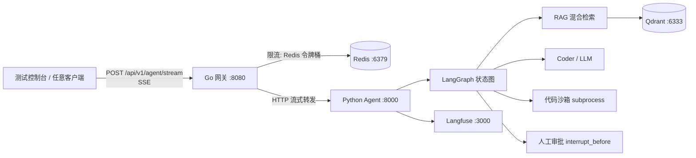
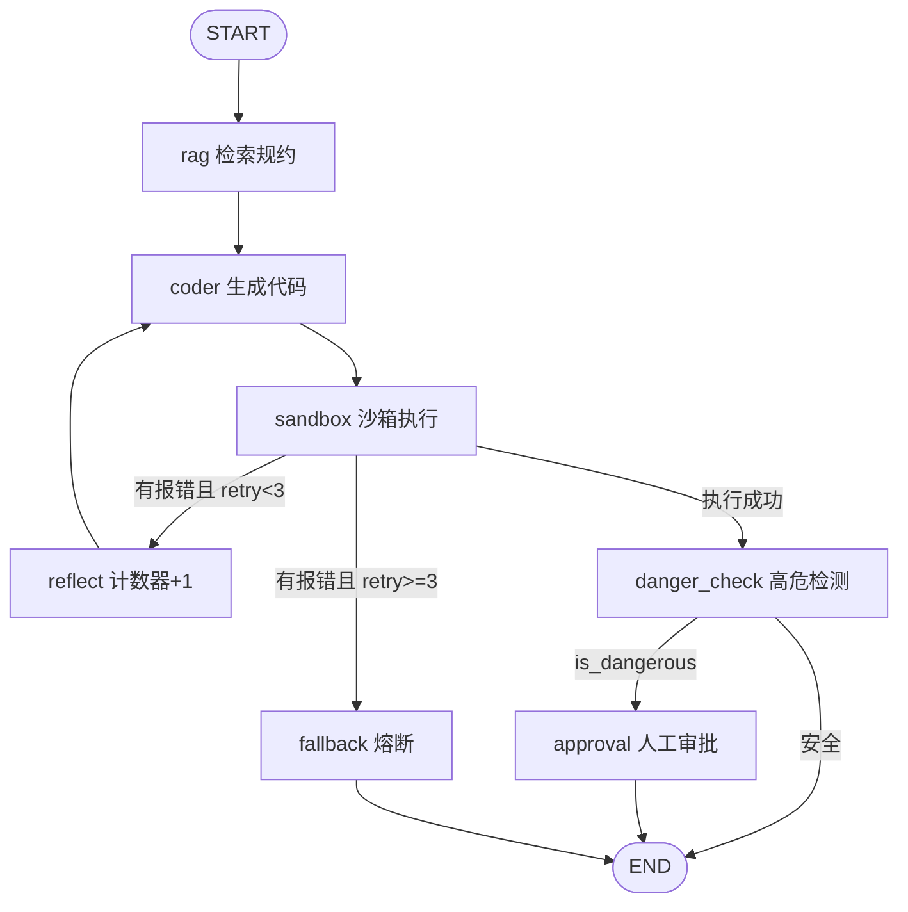

# Enterprise Agent Hub 项目文档

企业级智能体中枢：**Go 高性能网关 + Python LangGraph 核心大脑**，提供 SSE 流式对话、RAG 混合检索、代码沙箱执行、Reflexion 自愈与人工在环（Human-in-the-loop）审批能力。

---

## 1. 项目概览

| 维度 | 说明 |
|---|---|
| 定位 | 企业内部研发/运维自动化助手，可生成并安全执行 Python 脚本 |
| 架构模式 | 前后端分离 + 状态机驱动 + 跨语言（Go ⇄ Python）SSE 长连接 |
| 核心能力 | RAG 混合检索、代码自愈重试、高危动作人工审批、令牌桶限流、链路追踪 |
| 入口端口 | Go 网关 `8080`，Python Agent `8000` |

### 1.1 系统架构



### 1.2 技术栈

| 层 | 技术 |
|---|---|
| 接入层 | Go 1.26、Gin 1.12、go-redis v9、Context + `http.Flusher` 实现 SSE |
| 编排层 | FastAPI、LangGraph（StateGraph + MemorySaver）、Uvicorn |
| 检索层 | rank-bm25 + jieba（稀疏）、向量语义召回（生产对接 Qdrant）、RRF 倒数排名融合、BGE-Reranker 二次精排 |
| 模型层 | langchain-openai 兼容协议，默认 DeepSeek |
| 可观测 | Langfuse（可选）、自定义 Tracer 装饰器 |
| 中间件 | Docker Compose：Redis / Qdrant / Langfuse / Postgres |

---

## 2. 目录结构

```
agent/
├── agent_service/                 # Python 核心服务
│   ├── server.py                  # FastAPI 入口（/health、/stream、/approve）
│   ├── requirements.txt
│   ├── graph/
│   │   ├── state.py               # AgentState（TypedDict）全生命周期状态
│   │   ├── nodes.py               # 7 个节点实现
│   │   └── workflow.py            # 状态图组装、条件路由、编译与挂起点
│   ├── rag/
│   │   ├── hybrid_retriever.py    # BM25 + 向量召回 + RRF 融合
│   │   └── reranker.py            # BGE 精排 + 无模型时降级打分
│   └── tracer/observe_setup.py    # Langfuse / Tracer
├── gateway/                       # Go 高性能网关
│   ├── main.go                    # 路由、SSE 头、超时与断连控制、内嵌前端页面
│   ├── web/index.html             # 简易前端测试控制台（SSE 时间线 + 人工审批）
│   ├── client/agent_client.go     # 调用 Python 服务的流式客户端
│   └── middleware/ratelimit.go    # Redis 固定窗口/令牌桶限流
├── docker-compose.yml             # Redis / Qdrant / Langfuse / Postgres
├── Makefile                       # 一键启动与端到端联调命令
├── .env.example                   # 环境变量模板（.env 已被 .gitignore 忽略）
└── .gitignore
```

---

## 3. 核心组件

### 3.1 Go 网关（`gateway/`）

- **流式代理**：`POST /api/v1/agent/stream` 设置 `text/event-stream` 头，逐行读取 Python 端 SSE 并 `Flush` 给客户端。
- **断连控制**：监听 `c.Request.Context().Done()`，客户端关闭页面时立即终止下游推流，避免 Token 浪费。
- **超时保护**：级联 Context 120 秒超时，防止 Agent 死循环挂死连接。
- **限流**：`middleware.RedisTokenBucketLimiter`，按 `X-Tenant-ID`（缺省用客户端 IP）计数，默认 30 次/分钟；**Redis 故障时 Fail-open 放行**，保证核心可用性。
- **线程 ID**：未传 `thread_id` 时自动生成 `session_<纳秒>`。
- **测试控制台**：`GET /` 返回内嵌的 `gateway/web/index.html`（编译时通过 `go:embed` 打包），浏览器访问 `http://localhost:8080/` 即可发起任务、观察 SSE 时间线并完成人工审批。

### 3.2 Python Agent 服务（`agent_service/server.py`）

| 接口 | 方法 | 说明 |
|---|---|---|
| `/health` | GET | 健康检查 |
| `/stream` | POST | 流式执行 Agent 图，逐节点推送状态 |
| `/approve` | POST | 人工审批：`approved=true` 从快照断点恢复；`false` 置为 `REJECTED` 终止 |

请求体：

```json
{ "prompt": "请帮我写一个快速排序算法并测试验证", "thread_id": "thread_test_01" }
```

SSE 事件负载：

```json
{ "node": "coder", "status": "PROCESSING", "code": "...", "error": "", "retry_count": 0, "output": "" }
```

高危任务命中后额外推送挂起事件（前端据此显示审批面板）：

```json
{ "node": "INTERRUPT", "status": "WAITING_APPROVAL", "output": "⚠️ 涉及高危敏感操作，流程已安全挂起，等待主管人工点击审批！", "code": "..." }
```

流结束统一推送 `data: [DONE]`；网关侧异常会推送 `data: {"error": "..."}`。

### 3.3 LangGraph 状态机（`graph/`）



- **状态定义**（`state.py`）：`task / thread_id / rag_context / code / error_message / retry_count / is_dangerous / approved / status / final_output`。
- **节点职责**：

| 节点 | 作用 |
|---|---|
| `rag_node` | 混合检索 + 精排，拼装规约上下文 |
| `coder_node` | 调用 LLM 生成代码；存在 `error_message` 时进入 Reflexion 修复提示词 |
| `sandbox_node` | 临时文件 + `subprocess` 隔离执行，**5 秒硬超时**，结束后清理临时文件；兼容子进程无输出时 `stdout/stderr` 为 `None` 的情况，非零退出且无报错信息时回退为退出码提示，避免误判为执行成功 |
| `reflect_node` | 重试计数 +1，回流 coder 形成自愈闭环 |
| `danger_check_node` | 关键词命中（delete/drop/rmdir/remove/kill/reboot/shutdown/format）即判高危 |
| `approval_node` | 人工批准后才执行，追加"已获人工批准"标记 |
| `fallback_node` | 3 次自愈失败后熔断，输出失败原因 |

- **挂起点**：`compile(interrupt_before=["approval"])`，高危任务在审批前安全挂起，状态由 `MemorySaver` 快照保存，审批后 `stream(None, config)` 从断点无缝恢复。
- **自愈上限**：`retry_count >= 3` 直接转 `fallback`，防止无限循环。

### 3.4 RAG 混合检索（`rag/`）

1. **稀疏召回**：jieba 分词 → `BM25Okapi` 打分，擅长精确命中函数名/错误码等专有名词。
2. **稠密召回**：生产环境对接 Qdrant 向量库；当前实现对语义关键词做模拟打分，保证离线可演示。
3. **RRF 融合**：`score = Σ 1/(k + rank)`（k=60），只看相对排名，规避 BM25 与余弦相似度量纲不一致的问题。
4. **精排**：配置 `BGE_RERANKER_PATH` 时使用 BGE Cross-Encoder；未配置/加载失败时降级为 **jieba 分词后的关键词重合度打分**（而非单字符集合匹配，避免 `delete` 被拆成 `d/e/l/t` 造成误命中）。

### 3.5 可观测与配置（`tracer/observe_setup.py`）

`observe_node` 装饰器记录节点起止时间；设置 Langfuse 环境变量后自动上报 Trace，未启动时静默降级，不影响主流程。

---

## 4. 快速开始

### 4.1 前置条件

- Docker Desktop（WSL2 后端）已启动；Redis 未启动时网关限流会 Fail-open，不影响主流程联调
- Python 3.10+（示例环境为 `G:\agent_stu\.conda`，若 `python` 未加入 PATH，使用 `& "G:\agent_stu\.conda\python.exe"` 代替）
- Go 1.26+
- 可选：GNU Make（Windows 也可直接使用下方 PowerShell 命令）

### 4.2 启动步骤（Windows PowerShell）

> 需要三个终端窗口：终端 A 负责中间件与初始化，终端 B 启动 Python Agent，终端 C 启动 Go 网关。B、C 启动后会一直阻塞，属正常现象。

```powershell
# 终端 A：进入项目根目录
Set-Location g:\agent_stu\projects\05_enterprise_agent_hub\agent

# 1. 拉起中间件（Redis / Qdrant / Langfuse / Postgres）
docker compose up -d            # 旧版 Docker 使用 docker-compose up -d

# 2. 配置环境变量（.env 已被 .gitignore 忽略，不要提交）
Copy-Item .env.example .env
notepad .env                    # 填写 DEEPSEEK_API_KEY；不填时 coder 走离线兜底代码

# 3. 安装 Python 依赖
pip install -r agent_service\requirements.txt

# 4. 终端 B：启动 Python Agent（:8000）
python -m uvicorn agent_service.server:app --host 0.0.0.0 --port 8000

# 5. 终端 C：启动 Go 网关（:8080，前端页面随网关一起发布）
Set-Location gateway
go run main.go

# 6. 打开测试控制台
Start-Process http://localhost:8080/
```

Git Bash / Linux / macOS 或已安装 GNU Make 时，等价命令为：

```bash
make up            # 中间件
make run-agent     # 终端 B
make run-gateway   # 终端 C
```

### 4.3 端口清单

| 服务 | 端口 | 容器名 |
|---|---|---|
| 前端测试控制台 | 8080（由 Go 网关托管） | 本地进程 |
| Go 网关 | 8080 | 本地进程 |
| Python Agent | 8000 | 本地进程 |
| Redis | 6379 | `redis_gateway` |
| Qdrant | 6333 | `qdrant_rag` |
| Langfuse | 3000 | — |
| Postgres | 5432（内网） | — |

### 4.4 前端测试控制台

地址：`http://localhost:8080/`。页面由 Go 网关通过 `go:embed` 内嵌托管，无需单独启动静态服务器，也不存在跨域问题。

| 区域 | 用途 |
|---|---|
| 任务参数 | 租户 ID（写入 `X-Tenant-ID`，作为限流维度）、Thread ID（审批恢复依赖该 ID）、需求描述、预设任务 |
| 执行时间线 | 逐节点展示 `rag → coder → sandbox → reflect → danger_check → approval/fallback` 的 SSE 事件、代码、报错、标准输出与重试次数 |
| 人工审批 | 收到 `INTERRUPT / WAITING_APPROVAL` 后出现「批准执行 / 驳回任务」，调用 `/api/v1/agent/approve` 从断点恢复 |

页面内置三个预设：

- **正常任务**：验证完整链路与 SSE 流式输出
- **高危任务**：命中 `delete` 关键词，触发挂起与人工在环审批
- **超时/熔断**：验证沙箱 5 秒硬超时与 Reflexion/熔断策略（实际效果取决于模型输出）

> 控制台仅用于本地联调，没有登录与租户鉴权，请勿直接暴露到公网。

---

## 5. 环境变量

| 变量 | 默认值 | 说明 |
|---|---|---|
| `DEEPSEEK_API_KEY` | `mock-key` | 大模型密钥；缺失时 coder 走离线兜底代码 |
| `MODEL_NAME` | `deepseek-chat` | 模型名称 |
| `BASE_URL` | `https://api.deepseek.com` | OpenAI 兼容端点，可切换 vLLM/OpenAI |
| `BGE_RERANKER_PATH` | 空 | BGE-Reranker 本地模型目录；为空即启用降级精排 |
| `REDIS_ADDR` | `localhost:6379` | 网关限流 Redis 地址 |
| `AGENT_URL` | `http://localhost:8000` | 网关下游 Agent 地址 |
| `LANGFUSE_PUBLIC_KEY` / `LANGFUSE_SECRET_KEY` / `LANGFUSE_HOST` | mock / `http://localhost:3000` | 链路追踪配置 |

> `.env` 已在 `.gitignore` 中忽略，仓库内只保留 `.env.example` 占位模板。

---

## 6. 联调测试

### 6.1 启动前检查

```powershell
# Python Agent 健康检查
curl.exe -s http://localhost:8000/health     # {"status":"ok","server":"Python Agent Service"}

# Go 网关健康检查
curl.exe -s http://localhost:8080/health     # {"server":"Go Gateway","status":"ok"}

# 前端页面可访问性
curl.exe -s -o NUL -w "%{http_code}" http://localhost:8080/   # 200
```

### 6.2 前端测试流程（推荐）

打开 `http://localhost:8080/`，按以下场景逐项验证：

| 场景 | 操作 | 预期结果 |
|---|---|---|
| A 正常研发任务 | 点击「正常任务」→「开始执行」 | 时间线依次出现 `rag(PROCESSING)` → `coder`（展示生成代码）→ `sandbox`（展示执行输出）→ `danger_check(COMPLETED)` → `[DONE]`，提示「执行结束」 |
| B 高危任务挂起 | 点击「高危任务」→「开始执行」 | `danger_check(WAITING_APPROVAL)` 后出现 `INTERRUPT` 事件，审批面板弹出，提示「等待人工审批」 |
| C 审批通过 | 在场景 B 中点击「批准执行」 | 收到 `approval(COMPLETED)`，输出末尾追加 `[生产操作已获安全委员会人工批准，正式生效]` |
| D 审批驳回 | 在场景 B 中点击「驳回任务」 | 返回 `REJECTED`，任务终止；同一 Thread 不能重复审批，重试请点「新会话」 |
| E 自愈闭环 | 将 `.env` 的 Key 置为无效/占位，执行任意任务 | coder 走离线兜底代码，首次抛出 `NameError` → `reflect(retry_count=1)` → coder 修复 → `sandbox` 执行成功 |
| F 熔断降级 | 使用「超时/熔断」预设，模型生成死循环代码 | sandbox 5 秒超时报错，`retry_count>=3` 后 `fallback(FAILED)` 熔断并输出失败原因 |

> 场景 E 依赖「无有效 API Key」的兜底逻辑；场景 F 的结果取决于模型实际生成的代码。

### 6.3 命令行测试（Windows PowerShell）

> PowerShell 5.1 会吞掉原生命令参数中的双引号，直接 `curl.exe -d '{"prompt":"..."}'` 会被服务端判为非法 JSON。推荐用 `ConvertTo-Json` 管道到 `-d "@-"`。

```powershell
# 场景 A：正常任务（SSE 流式返回）
$body = @{ prompt = "请帮我写一个快速排序算法并测试验证"; thread_id = "thread_cli_normal_01" } | ConvertTo-Json
$body | curl.exe -N -X POST http://localhost:8080/api/v1/agent/stream `
  -H "Content-Type: application/json" -H "X-Tenant-ID: tenant_cli_001" -d "@-"

# 场景 B：高危任务（记录 thread_id，下一步恢复必须一致）
$body = @{ prompt = "执行脚本清空临时目录下的所有无用数据文件 delete all logs"; thread_id = "thread_cli_danger_02" } | ConvertTo-Json
$body | curl.exe -N -X POST http://localhost:8080/api/v1/agent/stream `
  -H "Content-Type: application/json" -H "X-Tenant-ID: tenant_cli_002" -d "@-"

# 场景 C：审批通过，从断点恢复执行
$body = @{ thread_id = "thread_cli_danger_02"; approved = $true } | ConvertTo-Json
$body | curl.exe -N -X POST http://localhost:8080/api/v1/agent/approve `
  -H "Content-Type: application/json" -d "@-"

# 场景 D：审批驳回（thread_id 换成 B 中未审批的会话）
$body = @{ thread_id = "thread_cli_danger_03"; approved = $false } | ConvertTo-Json
$body | curl.exe -N -X POST http://localhost:8080/api/v1/agent/approve `
  -H "Content-Type: application/json" -d "@-"
```

Git Bash / Linux / macOS 可直接使用 Makefile：

```bash
make test-stream     # 场景 A
make test-danger     # 场景 B
make test-approve    # 场景 C（thread_id 需与 test-danger 一致）
```

### 6.4 典型 SSE 输出

```
data: {"node":"rag","status":"PROCESSING","output":""}
data: {"node":"coder","status":"PROCESSING","code":"..."}
data: {"node":"sandbox","status":"PROCESSING","output":"..."}
data: {"node":"danger_check","status":"WAITING_APPROVAL","output":""}
data: {"node":"INTERRUPT","status":"WAITING_APPROVAL","output":"⚠️ 涉及高危敏感操作，流程已安全挂起..."}
data: {"node":"approval","status":"COMPLETED","output":"...[生产操作已获安全委员会人工批准，正式生效]"}
data: [DONE]
```

### 6.5 限流验证（可选，需 Redis 在线）

```powershell
# 同一租户 1 分钟内第 31 次请求应返回 429
1..35 | ForEach-Object {
  curl.exe -s -o NUL -w "%{http_code} " "http://localhost:8080/health" -H "X-Tenant-ID: tenant_limit_demo"
}
Write-Output ""
```

预期前 30 次返回 `200`，之后返回 `429`。Redis 宕机时中间件 Fail-open，全部返回 `200`。

---

## 7. 关键设计说明

| 设计点 | 原因 |
|---|---|
| Go 网关 + `c.Request.Context().Done()` | 高并发 SSE 下及时感知客户端断开，停止下游推流，节省模型 Token |
| 限流 Fail-open | Redis 宕机不能让全站业务瘫痪，优先保证可用性 |
| `interrupt_before` + Checkpointer | 高危动作必须在图层面强制挂起，而非靠业务代码自觉 |
| Reflexion 3 次上限 | 错误堆栈回灌 LLM 自愈，同时用次数上限防止死循环爆炸 |
| 沙箱 5 秒硬超时 + 临时文件清理 | 隔离不可信代码，避免死循环/资源耗尽 |
| RRF 而非分数相加 | 稀疏与稠密分数量纲不同，按排名融合更稳健 |
| Reranker 可降级 | 无 GPU/无模型权重时仍能跑通全流程，便于演示与入门 |

---

## 8. 已知问题与改进方向

以下为当前仍需处理的待修项，建议优先处理：

1. **Checkpointer 仅 `MemorySaver`**：进程重启即丢失断点，生产环境建议替换为 `PostgresSaver`。
2. **`dense_search` 为模拟实现**：生产需接入 Qdrant + Embedding 模型。
3. **沙箱仅超时隔离**：未限制内存、网络与文件系统访问；且超时只终止直接子进程，生成代码自行派生的孙进程可能残留，生产建议容器化或使用 Job Object / `firejail` 级别的强制清理与更强隔离。
4. **审批鉴权缺失**：`/approve` 未校验操作者身份与租户权限，建议接入统一鉴权。
5. **前端控制台仅用于本地联调**：无登录、无租户隔离，且默认与网关同源部署；若独立部署需补充 CORS 与认证。
6. **`hub_graph.stream` 为同步生成器**：在 FastAPI 异步路由中直接迭代会阻塞事件循环，高并发下建议改用 `astream` 或放入线程池。
7. **挂起事件可能重复推送**：`/stream` 在每个节点事件后都会检查 `get_state`，`INTERRUPT` 事件可能被推送两次；测试前端已做去重，服务端可将检查移到循环外。

---

## 附：文档维护

- 架构变更时同步更新第 1、3 节的图与组件表
- 接口签名变更时同步更新第 3.2 节与第 6 节示例
- 前端或启动方式变更时同步更新第 4、6 节命令与测试流程
