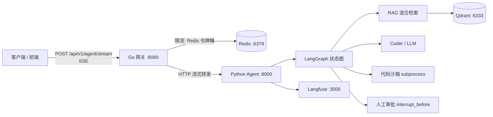
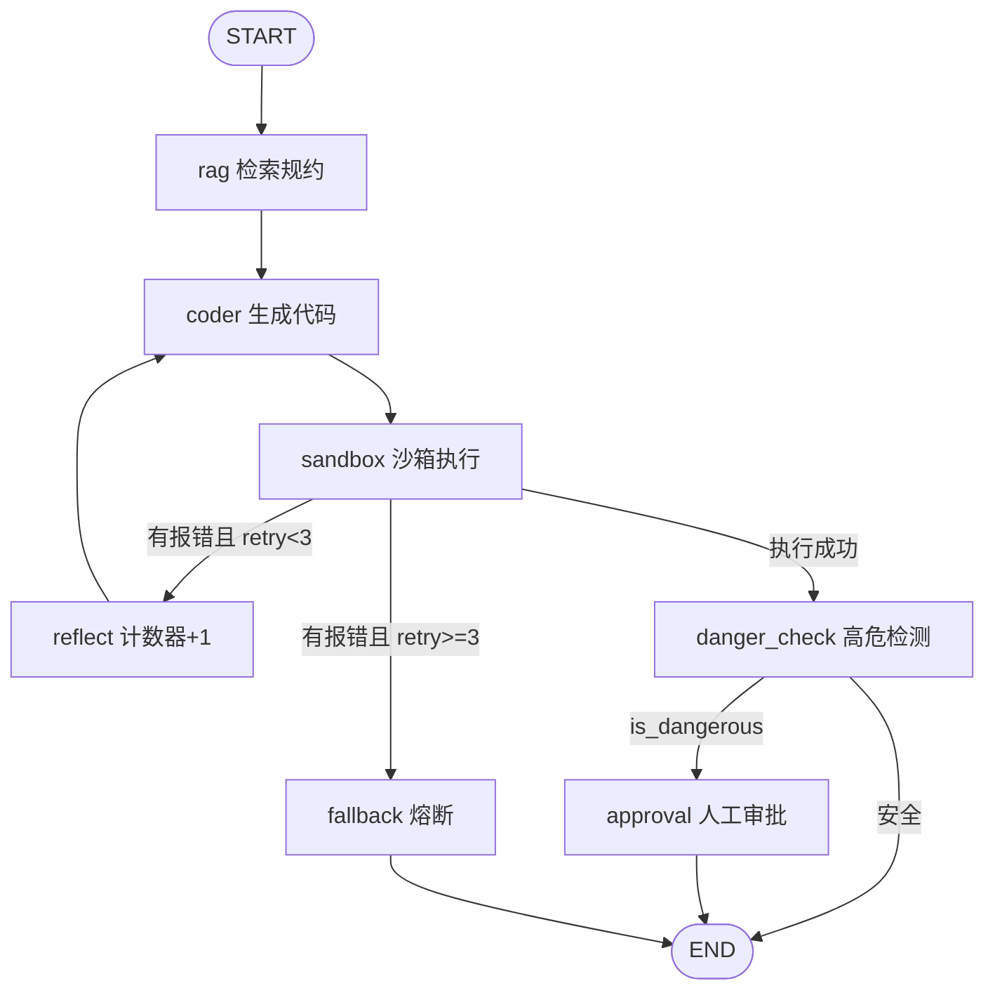

# Enterprise Agent Hub 项目文档

企业级智能体中枢：**Go 高性能网关 + Python LangGraph 核心大脑**，提供 SSE 流式对话、RAG 混合检索、代码沙箱执行、Reflexion 自愈与人工在环（Human-in-the-loop）审批能力。

---

## 1. 项目概览

| 维度 | 说明 |
|---|---|
| 定位 | 企业内部研发/运维自动化助手，可生成并安全执行 Python 脚本 |
| 架构模式 | 前后端分离 + 状态机驱动 + 跨语言（Go ⇄ Python）SSE 长连接 |
| 核心能力 | RAG 混合检索、代码自愈重试、高危动作人工审批、令牌桶限流、链路追踪 |
| 入口端口 | Go 网关 `8080`，Python Agent `8000` |

### 1.1 系统架构



### 1.2 技术栈

| 层 | 技术 |
|---|---|
| 接入层 | Go 1.26、Gin 1.12、go-redis v9、Context + `http.Flusher` 实现 SSE |
| 编排层 | FastAPI、LangGraph（StateGraph + MemorySaver）、Uvicorn |
| 检索层 | rank-bm25 + jieba（稀疏）、向量语义召回（生产对接 Qdrant）、RRF 倒数排名融合、BGE-Reranker 二次精排 |
| 模型层 | langchain-openai 兼容协议，默认 DeepSeek |
| 可观测 | Langfuse（可选）、自定义 Tracer 装饰器 |
| 中间件 | Docker Compose：Redis / Qdrant / Langfuse / Postgres |

---

## 2. 目录结构

```
agent/
├── agent_service/                 # Python 核心服务
│   ├── server.py                  # FastAPI 入口（/health、/stream、/approve）
│   ├── requirements.txt
│   ├── graph/
│   │   ├── state.py               # AgentState（TypedDict）全生命周期状态
│   │   ├── nodes.py               # 7 个节点实现
│   │   └── workflow.py            # 状态图组装、条件路由、编译与挂起点
│   ├── rag/
│   │   ├── hybrid_retriever.py    # BM25 + 向量召回 + RRF 融合
│   │   └── reranker.py            # BGE 精排 + 无模型时降级打分
│   └── tracer/observe_setup.py    # Langfuse / Tracer
├── gateway/                       # Go 高性能网关
│   ├── main.go                    # 路由、SSE 头、超时与断连控制
│   ├── client/agent_client.go     # 调用 Python 服务的流式客户端
│   └── middleware/ratelimit.go    # Redis 固定窗口/令牌桶限流
├── docker-compose.yml             # Redis / Qdrant / Langfuse / Postgres
├── Makefile                       # 一键启动与端到端联调命令
├── .env.example                   # 环境变量模板（.env 已被 .gitignore 忽略）
└── .gitignore
```

---

## 3. 核心组件

### 3.1 Go 网关（`gateway/`）

- **流式代理**：`POST /api/v1/agent/stream` 设置 `text/event-stream` 头，逐行读取 Python 端 SSE 并 `Flush` 给客户端。
- **断连控制**：监听 `c.Request.Context().Done()`，客户端关闭页面时立即终止下游推流，避免 Token 浪费。
- **超时保护**：级联 Context 120 秒超时，防止 Agent 死循环挂死连接。
- **限流**：`middleware.RedisTokenBucketLimiter`，按 `X-Tenant-ID`（缺省用客户端 IP）计数，默认 30 次/分钟；**Redis 故障时 Fail-open 放行**，保证核心可用性。
- **线程 ID**：未传 `thread_id` 时自动生成 `session_<纳秒>`。

### 3.2 Python Agent 服务（`agent_service/server.py`）

| 接口 | 方法 | 说明 |
|---|---|---|
| `/health` | GET | 健康检查 |
| `/stream` | POST | 流式执行 Agent 图，逐节点推送状态 |
| `/approve` | POST | 人工审批：`approved=true` 从快照断点恢复；`false` 置为 `REJECTED` 终止 |

请求体：

```json
{ "prompt": "请帮我写一个快速排序算法并测试验证", "thread_id": "thread_test_01" }
```

SSE 事件负载：

```json
{ "node": "coder", "status": "PROCESSING", "code": "...", "error": "", "retry_count": 0, "output": "" }
```

### 3.3 LangGraph 状态机（`graph/`）



- **状态定义**（`state.py`）：`task / thread_id / rag_context / code / error_message / retry_count / is_dangerous / approved / status / final_output`。
- **节点职责**：

| 节点 | 作用 |
|---|---|
| `rag_node` | 混合检索 + 精排，拼装规约上下文 |
| `coder_node` | 调用 LLM 生成代码；存在 `error_message` 时进入 Reflexion 修复提示词 |
| `sandbox_node` | 临时文件 + `subprocess` 隔离执行，**5 秒硬超时**，结束后清理临时文件 |
| `reflect_node` | 重试计数 +1，回流 coder 形成自愈闭环 |
| `danger_check_node` | 关键词命中（delete/drop/rmdir/remove/kill/reboot/shutdown/format）即判高危 |
| `approval_node` | 人工批准后才执行，追加"已获人工批准"标记 |
| `fallback_node` | 3 次自愈失败后熔断，输出失败原因 |

- **挂起点**：`compile(interrupt_before=["approval"])`，高危任务在审批前安全挂起，状态由 `MemorySaver` 快照保存，审批后 `stream(None, config)` 从断点无缝恢复。
- **自愈上限**：`retry_count >= 3` 直接转 `fallback`，防止无限循环。

### 3.4 RAG 混合检索（`rag/`）

1. **稀疏召回**：jieba 分词 → `BM25Okapi` 打分，擅长精确命中函数名/错误码等专有名词。
2. **稠密召回**：生产环境对接 Qdrant 向量库；当前实现对语义关键词做模拟打分，保证离线可演示。
3. **RRF 融合**：`score = Σ 1/(k + rank)`（k=60），只看相对排名，规避 BM25 与余弦相似度量纲不一致的问题。
4. **精排**：配置 `BGE_RERANKER_PATH` 时使用 BGE Cross-Encoder；未配置/加载失败时降级为 **jieba 分词后的关键词重合度打分**（而非单字符集合匹配，避免 `delete` 被拆成 `d/e/l/t` 造成误命中）。

### 3.5 可观测与配置（`tracer/observe_setup.py`）

`observe_node` 装饰器记录节点起止时间；设置 Langfuse 环境变量后自动上报 Trace，未启动时静默降级，不影响主流程。

---

## 4. 快速开始

### 4.1 前置条件

- Docker Desktop（WSL2 后端）已启动
- Python 3.10+（示例环境为 `G:\agent_stu\.conda`）
- Go 1.26+

### 4.2 步骤

```bash
# 1. 拉起中间件（Redis / Qdrant / Langfuse / Postgres）
make up

# 2. 配置环境变量（不要提交 .env）
cp .env.example .env   # Windows: copy .env.example .env
# 填写 DEEPSEEK_API_KEY

# 3. 安装 Python 依赖
pip install -r agent_service/requirements.txt

# 4. 启动 Python Agent（:8000）
make run-agent

# 5. 启动 Go 网关（:8080）
make run-gateway
```

### 4.3 端口清单

| 服务 | 端口 | 容器名 |
|---|---|---|
| Go 网关 | 8080 | 本地进程 |
| Python Agent | 8000 | 本地进程 |
| Redis | 6379 | `redis_gateway` |
| Qdrant | 6333 | `qdrant_rag` |
| Langfuse | 3000 | — |
| Postgres | 5432（内网） | — |

---

## 5. 环境变量

| 变量 | 默认值 | 说明 |
|---|---|---|
| `DEEPSEEK_API_KEY` | `mock-key` | 大模型密钥；缺失时 coder 走离线兜底代码 |
| `MODEL_NAME` | `deepseek-chat` | 模型名称 |
| `BASE_URL` | `https://api.deepseek.com` | OpenAI 兼容端点，可切换 vLLM/OpenAI |
| `BGE_RERANKER_PATH` | 空 | BGE-Reranker 本地模型目录；为空即启用降级精排 |
| `REDIS_ADDR` | `localhost:6379` | 网关限流 Redis 地址 |
| `AGENT_URL` | `http://localhost:8000` | 网关下游 Agent 地址 |
| `LANGFUSE_PUBLIC_KEY` / `LANGFUSE_SECRET_KEY` / `LANGFUSE_HOST` | mock / `http://localhost:3000` | 链路追踪配置 |

> `.env` 已在 `.gitignore` 中忽略，仓库内只保留 `.env.example` 占位模板。

---

## 6. 联调测试

`Makefile` 内置三条端到端场景，均通过 Go 网关发起：

```bash
# 场景 A：正常研发任务（SSE 流式返回）
make test-stream

# 场景 B：高危任务（触发高危检测 → 挂起等待审批）
make test-danger

# 场景 C：审批通过，从断点恢复执行
make test-approve
```

典型 SSE 输出（节选）：

```
data: {"node":"rag","status":"PROCESSING","output":""}
data: {"node":"coder","status":"PROCESSING","code":"..."}
data: {"node":"INTERRUPT","status":"WAITING_APPROVAL","output":"⚠️ 涉及高危敏感操作，流程已安全挂起..."}
data: {"node":"approval","status":"COMPLETED","output":"...[生产操作已获安全委员会人工批准，正式生效]"}
data: [DONE]
```

---

## 7. 关键设计说明

| 设计点 | 原因 |
|---|---|
| Go 网关 + `c.Request.Context().Done()` | 高并发 SSE 下及时感知客户端断开，停止下游推流，节省模型 Token |
| 限流 Fail-open | Redis 宕机不能让全站业务瘫痪，优先保证可用性 |
| `interrupt_before` + Checkpointer | 高危动作必须在图层面强制挂起，而非靠业务代码自觉 |
| Reflexion 3 次上限 | 错误堆栈回灌 LLM 自愈，同时用次数上限防止死循环爆炸 |
| 沙箱 5 秒硬超时 + 临时文件清理 | 隔离不可信代码，避免死循环/资源耗尽 |
| RRF 而非分数相加 | 稀疏与稠密分数量纲不同，按排名融合更稳健 |
| Reranker 可降级 | 无 GPU/无模型权重时仍能跑通全流程，便于演示与入门 |

---

## 8. 已知问题与改进方向

以下为代码静态阅读发现的待修项，建议优先处理：

1. **`server.py` 节点字段读取方式错误**：`node_update("status", "PROCESSING")` 以函数方式调用字典，运行时会抛 `TypeError`；应改为 `node_update.get("status", "PROCESSING")`（`/approve` 处已是正确写法）。
2. **`/stream` 的 `StreamingResponse` 缩进在异步生成器内部**，导致路由实际返回 `None`，SSE 无法正常输出；应移到 `event_generator` 定义之后作为路由返回值。
3. **`nodes.py` 导入包名与依赖不一致**：`langgraph_core.message`、`langgraph_openai` 应为 `langchain_core.messages`、`langchain_openai`（`requirements.txt` 中装的是后者）。
4. **Checkpointer 仅 `MemorySaver`**：进程重启即丢失断点，生产环境建议替换为 `PostgresSaver`。
5. **`dense_search` 为模拟实现**：生产需接入 Qdrant + Embedding 模型。
6. **沙箱仅超时隔离**：未限制内存、网络与文件系统访问，生产建议容器化或 `firejail` 级别的更强隔离。
7. **审批鉴权缺失**：`/approve` 未校验操作者身份与租户权限，建议接入统一鉴权。

---

## 附：文档维护

- 架构变更时同步更新第 1、3 节的图与组件表
- 接口签名变更时同步更新第 3.2 节与第 6 节示例
